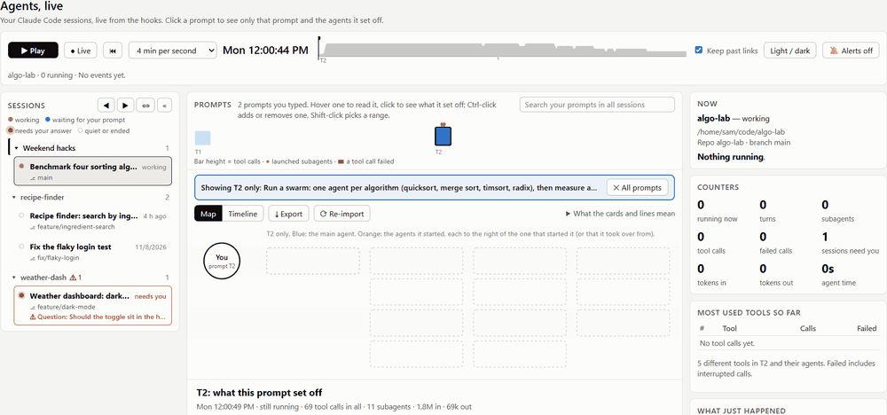
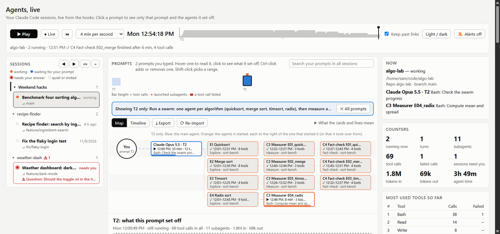
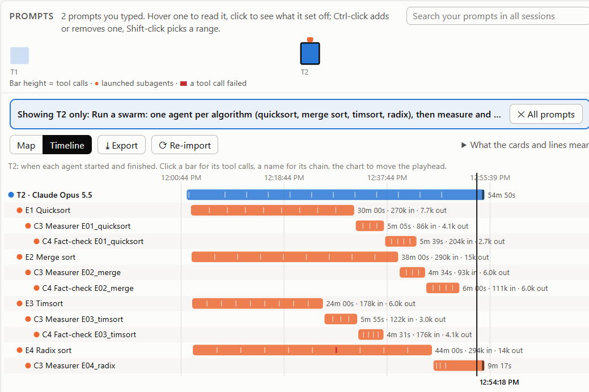
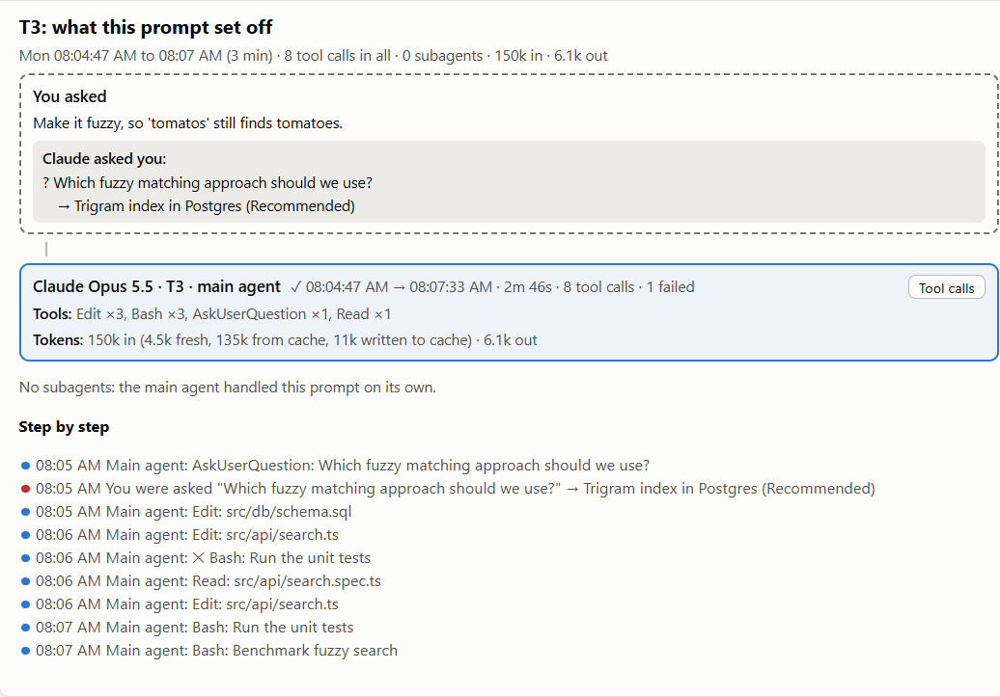
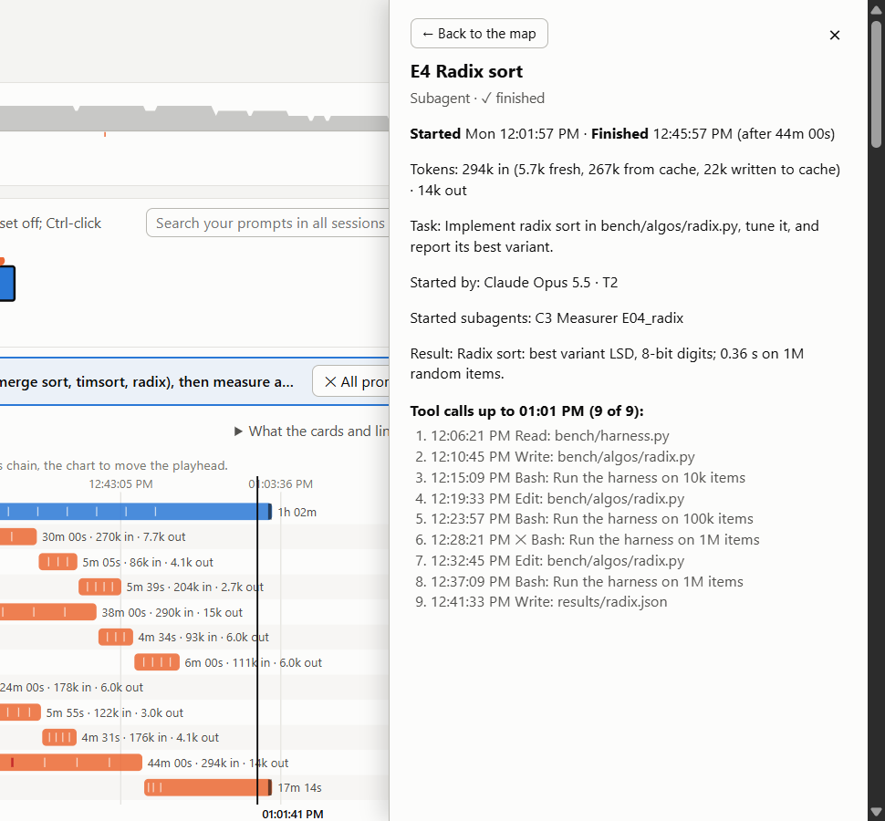
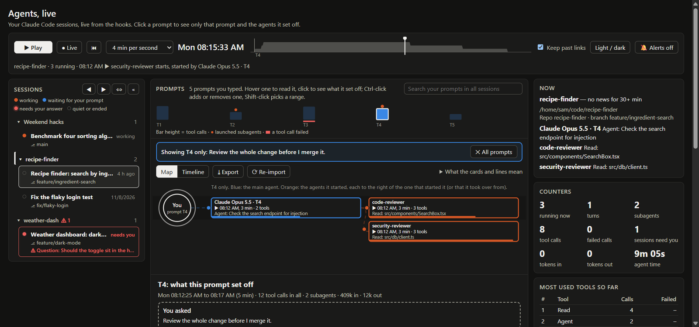
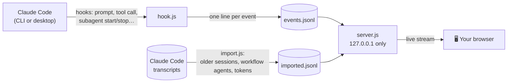

<div align="center">

# 🛰️ Agent Monitor for Claude Code

**See what your agents are actually doing.**<br>
Every session, every prompt, every subagent and every swarm, live in your browser and ready to replay.

[](https://omer-parvez.github.io/claude-agent-monitor/)


[](LICENSE)



<sub>A workflow swarm replaying: four explorers, each handing over to a measurer and then a fact-checker. Made-up demo data.</sub>

</div>

---

You ask Claude for one thing, and a minute later five subagents are reading files, a reviewer is checking the diff, and a workflow is fanning out across a dozen agents. Claude Code's chat shows you a summary. **Agent Monitor shows you the whole picture**: who started whom, what each agent is doing right now, when it started and finished, and how many tokens it used.

> 👉 **[Open the live demo](https://omer-parvez.github.io/claude-agent-monitor/)**. It's the real page with made-up sessions, so you can click around before installing anything.

## ✨ What you get

<table>
<tr>
<td width="50%" valign="top">

### 🗺️ The map
Your prompt on the left, the main agent in **blue**, and every agent it started in **orange**, to the right of whoever started it. Cards flash with each tool call, and links pulse while work flows.

</td>
<td width="50%" valign="top">

### 📊 The timeline
One bar per agent, from start to finish, with a tick for every tool call and red marks where something failed. Click a bar for its full list of tool calls. Click a name to see just that agent's chain.

</td>
</tr>
<tr>
<td></td>
<td></td>
</tr>
<tr>
<td width="50%" valign="top">

### 📖 The story of a prompt
What you asked, what Claude asked you back (and what you answered), which agents ran, their tasks and reports, and every step in time order.

</td>
<td width="50%" valign="top">

### 🔍 Every agent, in detail
Started at, finished at, how long it ran, tokens in and out (fresh, from cache, written to cache), who started it, its task, its result and each tool call.

</td>
</tr>
<tr>
<td></td>
<td></td>
</tr>
</table>

### And more

| | |
|---|---|
| ⏯️ **Live or replay** | Follow what happens now, or press Play and watch a session unfold at 1 to 30 minutes per second. Long idle gaps are shortened. |
| 🎯 **One prompt at a time** | Click a prompt to see only that prompt and the agents it set off. Ctrl-click to add more, Shift-click for a range. |
| 🔴 **Needs you** | A red dot, a tab-title counter and optional desktop alerts when any session waits for your approval or answer. |
| 🐝 **Swarms and workflows** | Workflow agents show up with their own names and phases, each linked to the agent it took over from. |
| 🪙 **Tokens** | Per agent, per prompt and per session, read from Claude Code's own transcripts. |
| 🔎 **Search** | Find any prompt you typed, in any session, and jump straight to it. |
| 📤 **Export** | Save a session, or just the prompts you pick, as **one HTML file** that replays offline. Send it to a colleague; they need nothing installed. |
| 🗂️ **Matches the desktop app** | Same session titles, same custom sidebar groups, same order. |
| 🌙 **Light and dark** | Follows your system, or switch with one click. |

<details>
<summary><b>🌙 See it in dark mode</b></summary>
<br>

</details>

## 🚀 Quick start

**1. Install** (needs [Node.js](https://nodejs.org) 18 or newer, so `node --version` works in a terminal):

```bash
claude plugin marketplace add omer-parvez/claude-agent-monitor
claude plugin install agent-monitor@agent-monitor-local
```

**2. Restart Claude Code.** The plugin's hooks start logging with your next session.

**3. Open the monitor.** In any Claude Code session, type:

```
/agent-monitor:open
```

Claude prints a link like `http://127.0.0.1:7788/?k=…`. Open it, and your older sessions are already there, imported from Claude Code's transcripts. `/agent-monitor:close` stops it.

<details>
<summary><b>⌨️ Keyboard shortcuts</b></summary>

| Key | Does |
|---|---|
| <kbd>Space</kbd> | Play / pause |
| <kbd>L</kbd> | Back to live |
| <kbd>[</kbd> <kbd>]</kbd> | Previous / next session |
| <kbd>Home</kbd> | Back to the start |
| <kbd>Esc</kbd> | Close the details panel, then leave the prompt view |
| <kbd>←</kbd> <kbd>→</kbd> on the time bar | Move 10 minutes |

</details>

## 🔒 Private by design

- **Nothing leaves your computer.** The page is served from `127.0.0.1` only and makes no network calls. The code has zero dependencies, so there's nothing to audit but these few files.
- **No file contents, no command output.** Only tool names and one-line summaries are kept, such as `Edit src/api/search.ts` or `Bash: Run the unit tests`.
- **Secrets are masked** before anything is written: bearer tokens, `password=`/`token=`/`api_key=` values, `--password` flags, common API key formats and URL query strings become `***`.
- **A key in the link.** Other programs and users on your computer can't read your sessions by calling the port.

<details>
<summary><b>Exactly what is recorded, and where</b></summary>
<br>

The plugin's hooks append one short line per event to `~/.claude/agent-monitor/events.jsonl`; the import writes `~/.claude/agent-monitor/imported.jsonl` from your transcripts.

Each line holds: the time, the session, the folder, the tool name, and a short summary. The summaries are:

- for a shell command, Claude's one-line description of it; when there is none, only the program name (`curl (command not shown)`), never its arguments;
- file paths, search patterns, and web addresses without their query string;
- your prompt (first 300 characters), a subagent's report (first 300), your answers to Claude's questions, and the first line of an error;
- when a turn or subagent stops, its token counts (numbers only).

Masking secrets is best effort: a secret pasted into a prompt without a telltale shape can still be stored. To record no prompt text, reports or answers at all (only tool names, paths and timings), add this to your Claude Code settings:

```json
{ "env": { "AGENT_MONITOR_TEXT": "off" } }
```

On macOS and Linux the folder and files are readable by you only. The page also reads, without changing anything, the Claude desktop app's session list (titles, folders, sidebar groups), so its names and groups match the app.

</details>

## ⚙️ How it works



<details>
<summary><b>Settings</b></summary>
<br>

All optional environment variables:

| Variable | Default | What it does |
|---|---|---|
| `AGENT_MONITOR_PORT` | `7788` | Port of the page |
| `AGENT_MONITOR_DAYS` | `30` | How many days of events the page loads |
| `AGENT_MONITOR_MAX_MB` | `20` | Size at which `events.jsonl` rolls over to `events.1.jsonl` |
| `AGENT_MONITOR_TEXT` | on | `off` keeps no prompt text, reports or answers |

</details>

<details>
<summary><b>FAQ</b></summary>
<br>

**Does it slow Claude down?** No. The hooks run asynchronously and write one short line each; they never block Claude.

**Why is a workflow's agent list empty while it runs?** The live hooks don't report workflow agents. Click **⟳ Re-import** on the page and they appear with their names.

**Does it work on macOS and Linux?** It's built on plain Node.js and tested on Windows. macOS and Linux should work but haven't been tested yet; reports are welcome.

**Can I share a replay?** Yes: **⤓ Export** saves one HTML file. It contains your prompt text and the agents' reports, so read it before you send it.

</details>

<details>
<summary><b>Files, and building the demo</b></summary>
<br>

- `agent-monitor/hooks/hooks.json`: the logging hooks.
- `agent-monitor/hook.js`: turns one hook event into one log line. Self-test: `node agent-monitor/hook.js --self-test`.
- `agent-monitor/import.js`: imports older sessions from transcripts. Self-test: `node agent-monitor/import.js --self-test`.
- `agent-monitor/server.js`: the local page server (`node agent-monitor/server.js [port]`, `--stop`).
- `agent-monitor/index.html`: the page.
- `demo/make-demo.js`: builds the made-up demo data and `docs/index.html`, the live demo page.
- `demo/make-images.py`: crops demo screenshots into the images above (needs Pillow).

</details>

## 🧹 Remove

```bash
claude plugin uninstall agent-monitor@agent-monitor-local
```

Then delete `~/.claude/agent-monitor/` to remove the logs and the key.

---

<div align="center">

Made by **Omer Parvez** · [MIT License](LICENSE)<br>
If it helps you see what your agents are up to, a ⭐ helps others find it.

</div>
