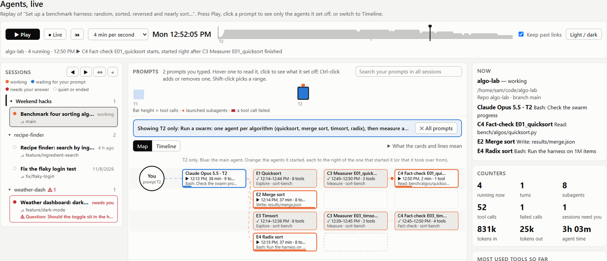
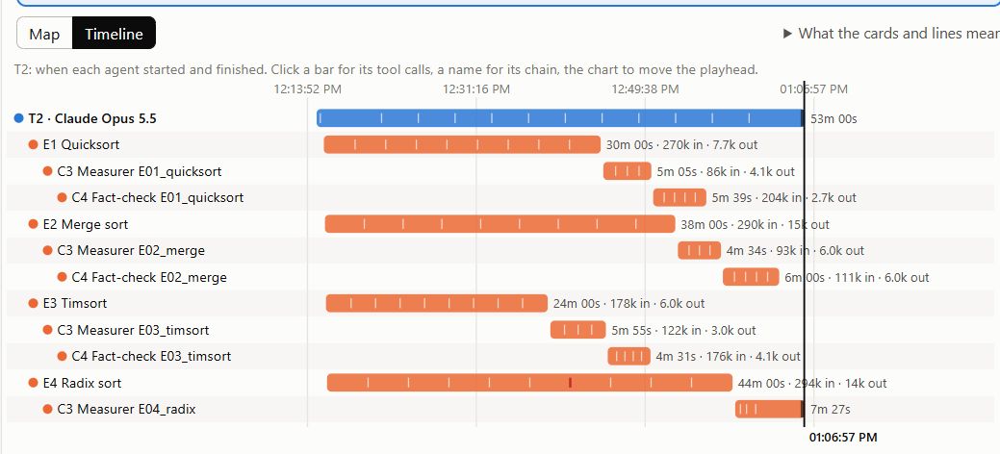

# "See it in action" fields

Paste each part into its field on Agensi's form. The images load from GitHub, so push `docs/images/replay-*.png` first, or upload them with the form's image button instead.

The numbers, times and table below are real output of the skill's summary, run on the made-up demo session.

---

## The request (what the buyer types)

Replay the session where we ran the sorting-algorithm swarm. I want a timeline of when each agent started and finished, and how many tokens they used.

---

## The result (what your agent delivers)

Here's the replay of your swarm session, **"Set up a benchmark harness: random, sorted, reversed and nearly sorte…"**.

**2 prompts, 11 subagents, 75 tool calls (1 failed), 2.0M tokens in, 76k out.**

| Agent | Started | Finished | Took | Tool calls | Tokens in / out |
|---|---|---|---|---|---|
| Main agent, prompt 1 | 11:55:57 | 11:57:10 | 1m 13s | 6 | 185k / 7k |
| Main agent, prompt 2 | 12:13:57 | still running | 50m 12s | 12 | – (counted when it stops) |
| E1 Quicksort | 12:14:44 | 12:44:44 | 30m 00s | 8 | 270k / 8k |
| E2 Merge sort | 12:14:51 | 12:52:51 | 38m 00s | 8 | 290k / 15k |
| E3 Timsort | 12:14:58 | 12:38:58 | 24m 00s | 8 | 178k / 6k |
| E4 Radix sort | 12:15:05 | 12:59:05 | 44m 00s | 9 | 294k / 14k |
| C3 Measurer E03_timsort | 12:39:23 | 12:45:18 | 5m 55s | 3 | 122k / 3k |
| C3 Measurer E01_quicksort | 12:45:09 | 12:50:14 | 5m 05s | 3 | 86k / 4k |
| C4 Fact-check E03_timsort | 12:45:38 | 12:50:09 | 4m 31s | 4 | 176k / 4k |
| C4 Fact-check E01_quicksort | 12:50:34 | 12:56:13 | 5m 39s | 4 | 204k / 3k |
| C3 Measurer E02_merge | 12:53:16 | 12:57:50 | 4m 34s | 3 | 93k / 6k |
| C4 Fact-check E02_merge | 12:58:10 | 13:04:09 | 6m 00s | 4 | 111k / 6k |
| C3 Measurer E04_radix | 12:59:30 | still running | 4m 39s | 3 | – (counted when it stops) |

**What stands out**

- The four explorers ran **in parallel**, all starting within 21 seconds (12:14:44 to 12:15:05).
- **E4 Radix sort** was the slowest and the hungriest: 44 minutes and 294k tokens in. Its measurer is still running.
- Each explorer handed over to a measurer, then a fact-checker, within a minute of finishing; the timsort chain finished first.
- 1 tool call failed; the replay marks it in red on the timeline.

**Your replay:** `/home/sam/code/algo-lab/session-replay-2026-11-09-demo-sor.html`

One file, opens offline in any browser:

- **Map:** who started whom, with the main agent in blue and every subagent in orange. Press Play to watch the swarm unfold.

- **Timeline:** one bar per agent from start to finish, with a tick for each tool call and red for failures.

- **Story:** each agent's task, tools, tokens and report, in order.

**Next steps**

- Want me to open it in your browser?
- I can replay another session too; say which one, or I'll list them.
- If you share the file, read it first: it contains your prompts and the agents' reports.
