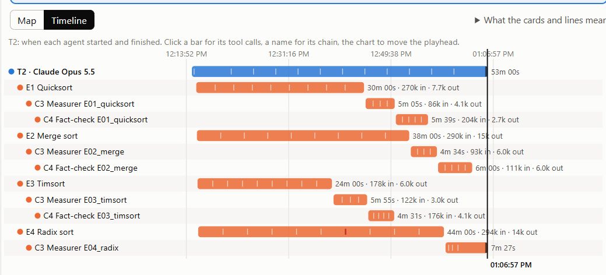
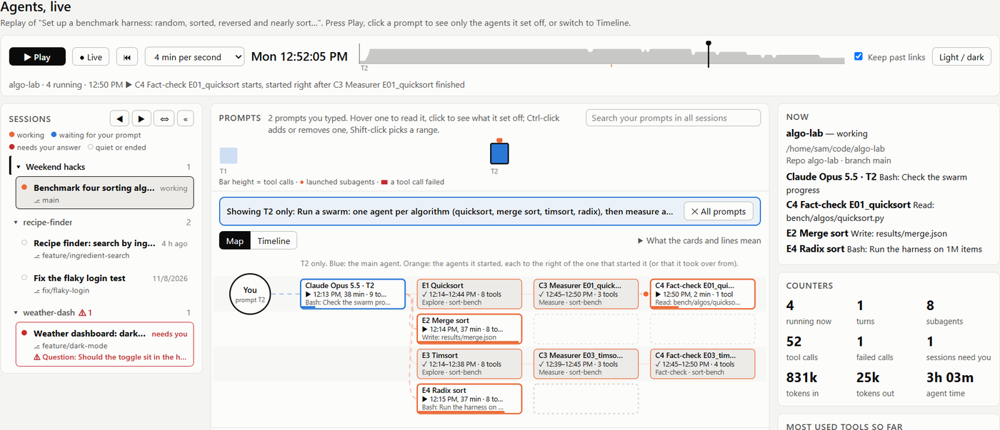

# Session Replay for Claude Code

Turn any Claude Code session into one offline HTML replay: every prompt, the main agent and each subagent or workflow agent it started, on a map and a timeline, with start and finish times and token counts.

**Try the page in your browser first:** [live demo with made-up sessions](https://omer-parvez.github.io/claude-agent-monitor/)

## Needs

- Claude Code
- Node.js 18 or newer (`node --version`)

## Use it

Just ask Claude, from the project folder you used Claude Code in:

- "Replay my last session"
- "Show a timeline of what the agents did in the session where we fixed the login bug"
- "Make a replay of yesterday's swarm run that I can share"

Claude finds the session, builds one HTML file, and shows a table of every agent with its start and finish times, tool calls and tokens, plus a few observations.

## The replay file

One file that opens offline in any browser, with nothing to install:

- **Map:** who started whom, with the main agent in blue and subagents in orange.
- **Timeline:** one bar per agent from start to finish, with a tick for each tool call and red for failures.
- **Story:** what you asked, the questions Claude asked back, and each agent's task, tools, tokens and report.
- **Play, pause and scrub** to watch the session unfold. Click a prompt to see only the agents it set off.

## Options

Claude uses these for you; you can also run the script yourself.

| Command | Does |
|---|---|
| `node scripts/replay.js` | Replays the newest session of the current folder |
| `node scripts/replay.js --list` | Lists this project's sessions, newest first |
| `node scripts/replay.js --session <id>` | Replays a given session (an id prefix is enough) |
| `node scripts/replay.js --out <file.html>` | Saves the replay to that path |
| `node scripts/replay.js --project <folder>` | Uses another project folder |

## Privacy

- Reads only the chosen project's Claude Code transcripts in `~/.claude/projects/<project>/`. Nothing else.
- Writes one HTML file. No network access, no packages, no settings changed.
- Keeps only tool names and one-line summaries, never file contents or command output.
- Text that looks like a secret (tokens, passwords, API keys, URL query strings) is masked as `***`.
- The file contains your prompts and the agents' reports, so read it before sharing.

## Troubleshooting

| Message | Fix |
|---|---|
| `No Claude Code transcripts found for <folder>` | Run it from the folder you used Claude Code in, or pass `--project <folder>` |
| `No session starting with ...` | Run `--list` and use one of the printed ids |
| `node` not found | Install Node.js 18+ from [nodejs.org](https://nodejs.org) |

## Live view of every session

This skill replays a session on request. For a page that follows all your sessions live, with alerts when one needs your input, get the free [Agent Monitor plugin](https://github.com/omer-parvez/claude-agent-monitor).

---

Made by Omer Parvez · [MIT License](../../LICENSE)
